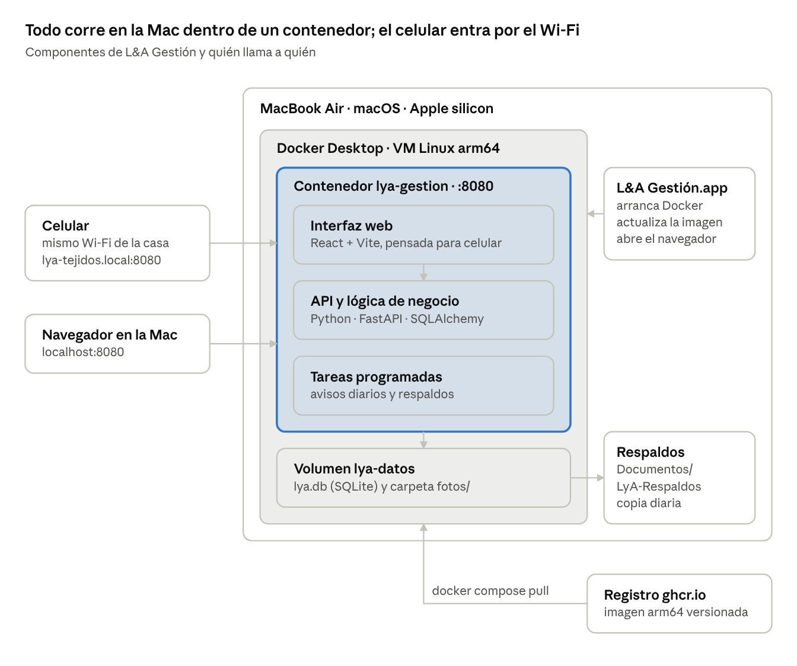

# L&A Tejidos — Arquitectura del sistema de gestión

Oct 23, 2026 · @Luciano

## Resumen y objetivos

L&A Gestión será una aplicación web local que corre en la MacBook Air de la propietaria, dentro de un único contenedor Docker, y se usa desde el navegador de la Mac o desde el celular conectado al mismo Wi-Fi. Cubre cuatro frentes: inventario (productos terminados e insumos), ventas y contabilidad de caja, avisos automáticos y estadísticas.

Objetivos de la versión 1:

- Saber en todo momento qué hay en existencia: bolsos, accesorios e insumos (hilos, cuentas de murano y cristal, herrajes, forros, argollas, empaques).

- Registrar una venta o un gasto en menos de un minuto, también desde el celular en una feria.

- Conocer el costo real y el margen de cada variante, incluidas las horas de trabajo a mano.

- Recibir avisos de insumos por agotarse, pedidos por entregar y abonos pendientes.

- Instalar y usar sin conocimientos técnicos; los datos no salen de la Mac, salvo las copias de respaldo.

Fuera de alcance en v1: facturación electrónica DIAN, tienda en línea, acceso desde fuera de la casa y contabilidad de partida doble.

## Contexto, usuaria y restricciones

La Mac comprada en 2023 es casi con certeza Apple silicon (M1 o M2), así que la imagen Docker se construye para linux/arm64. En 2023 Apple vendía la MacBook Air M1 (2020), la M2 de 13" (2022) y la M2 de 15" (2023); la M3 llegó en 2024. Ambos chips son compatibles con macOS 27 (fuente).

**Usuaria.** Maneja con soltura Instagram, TikTok y WhatsApp, pero no tiene conocimientos técnicos. Vende por redes con envíos a todo el país desde Pueblo Nuevo, Córdoba, con entrega inmediata y por encargo, y en ferias como el Showroom de Montería Design Week en la Universidad del Sinú.

**Qué confirmar en la Mac** (menú Apple → Acerca de esta Mac, salvo donde se indica):

| Dato | Por qué importa |
|---|---|
| Chip (M1 o M2) | Arquitectura de la imagen; cualquiera de los dos sirve |
| Memoria (8 o 16 GB) | Con 8 GB se limita Docker Desktop a unos 2 GB |
| Versión de macOS | Docker Desktop solo soporta la versión actual y las dos anteriores (fuente): hoy macOS 27, 26 o 15. Si tiene 14 Sonoma o anterior, hay que actualizar |
| Espacio libre ≥ 15 GB (Ajustes → General → Almacenamiento) | Docker Desktop, la imagen, fotos y respaldos |
| Celular: iPhone o Android | Android no siempre resuelve nombres .local |
| Acceso al router Wi-Fi | Reservar una IP fija para la Mac (opcional, recomendado) |
| Cuántas personas usan el sistema | Define si hace falta un usuario de ayudante |

**Restricciones de diseño:**

- Funciona sin internet: fuentes, íconos y librerías van dentro de la imagen, sin CDN.

- La Mac es un portátil: con la tapa cerrada o en reposo, el celular pierde acceso.

- Licencia: Docker Desktop es gratuito para empresas con menos de 250 empleados y menos de 10 millones de USD de ingresos anuales (fuente); el emprendimiento cumple de sobra.

- RAM limitada: un solo contenedor y SQLite en lugar de un servidor de base de datos aparte.

## Módulos funcionales

Seis módulos comparten una sola base de datos; ventas e inventario se alimentan entre sí, y contabilidad, avisos y estadísticas leen de ambos.

| Módulo | Qué resuelve | Pantallas y acciones clave |
|---|---|---|
| Inventario | Existencias de productos terminados (por modelo y color) e insumos | Catálogo con foto, stock por variante, entrada de insumos, órdenes de producción, vista de insumos (total, en producción, reservado, disponible), ajustes y mermas |
| Ventas y pedidos | Ventas de entrega inmediata, pedidos por encargo con abonos, arreglos, cambios, devoluciones y clases o talleres con cupo e inscritas | Venta rápida (3 toques) con comprobante en PDF, desglose de costos por pedido (insumos, mano de obra, envío) que por defecto muestra al cliente insumos y mano de obra separados, y ella lo cambia por pedido, pedidos con estado, fecha en que debe estar listo y fecha de entrega; calendario por mes y por semana con encargos, talleres y ferias, que sugiere cuándo empezar cada encargo (fecha de listo − horas de tejido ÷ horas que teje al día) y avisa, sin impedir guardarlo, si un encargo nuevo llena la semana, abonos, datos de envío, canal de venta |
| Clientes | Saber quién compra, cuánto compra y quién debe | Ficha con contactos (WhatsApp, Instagram/TikTok, correo, dirección de envío), historial de compras, total comprado, saldo pendiente y estado de cartera; botón para abrir el chat de WhatsApp |
| Contabilidad | Flujo de caja simple: cuánto entra, cuánto sale y cuánto queda | Cuentas (Efectivo, Nequi, Daviplata, banco) con saldo inicial que ella misma llena, ingresos, gastos por categoría, gastos fijos que ella define, solo como registro, transferencias, cierre mensual |
| Avisos | Que nada se olvide | Bandeja de avisos con contador, reglas configurables |
| Estadísticas | Decidir qué tejer, qué comprar y dónde vender | Tablero mensual y por rango de fechas |

**Avisos generados cada mañana y al abrir la app:**

- Insumo o producto en vitrina en amarillo («por agotarse») al llegar a su mínimo + 25 %, o en rojo («bajo mínimo») al quedar por debajo; el mínimo lo pone ella en cada insumo y cada variante. También avisa cuando a un encargo le falta algún insumo: al crearlo, y otra vez 3 días antes de su fecha de inicio sugerida (editable) si todavía no ha empezado.

- Encargo que debe estar listo hoy o en los próximos 3 días (anticipación editable), o que ya está atrasado.

- Pedido «Listo» con el 50 % restante sin cobrar, o que sigue sin cobrarse más días de los configurados (7 por defecto) después de quedar listo.

- Feria o evento próximo que ella registre, como el festival de cada noviembre, para preparar la vitrina con tiempo.

- Temporadas fuertes: Día de la Madre (mayo), Amor y Amistad (septiembre), Navidad; avisa 4 semanas antes.

- Producto sin ventas en 90 días (estancado en vitrina), o vendido por debajo de su costo.

- Último respaldo con más de 2 días.

**Estadísticas del tablero:**

- Ventas por día y por mes, gastos y ganancia, con comparación contra el mes anterior; productos en vitrina en unidades y en valor a costo y a precio de venta.

- Ventas por canal (Instagram, TikTok, WhatsApp, ferias, presencial) y por categoría (crochet, murano, cristal, talleres).

- Modelos y colores más vendidos; margen por modelo; productos estancados en vitrina.

- Ticket promedio, número de pedidos, ventas por cliente y clientes que más compran.

- Cartera total y por cliente, por antigüedad (0–30, 31–60 y más de 60 días); gastos por categoría, insumos más consumidos, merma por insumo y evolución del precio de cada insumo.

- Rendimiento de cada feria: ventas contra costo del stand.

**Reglas de negocio:**

- Vender un producto de vitrina descuenta su stock al guardar la venta. Un encargo no pasa por la vitrina: se fabrica para ese cliente.

- Toda fabricación es una orden de producción, para vitrina o para un encargo. Al crearla muestra el detalle de insumos que va a usar según la receta de la variante (las piezas únicas no tienen receta: los insumos se agregan a mano); al iniciarla pasa esos insumos a «En producción», donde dejan de estar disponibles pero siguen contando en la existencia total; al terminarla le pregunta cuánto usó realmente de cada insumo, con lo de la receta ya prellenado. Por cada insumo con sobrante, ella marca si aún sirve (vuelve a disponible) o no sirve (sale como merma). Lo usado se consume definitivamente y, si es de vitrina, suma las unidades a la variante. Si una orden se cancela, lo que no se usó vuelve a disponible. Se puede iniciar aunque falte algún insumo: el faltante queda en negativo, marcado en rojo, hasta registrar la compra.

- Costo de una variante = Σ (cantidad de insumo de su receta × precio vigente) + horas de tejido del modelo × valor hora editable (10.000 COP por defecto). Las horas cuentan todo el trabajo: tejer, armar, forrar y poner herrajes.

- Un encargo se cobra con 50 % de anticipo y 50 % al terminarlo, antes de entregar: el pedido no pasa a «Enviado» ni «Entregado» con saldo pendiente. Saldo = total − Σ pagos. La cartera de un cliente es la suma de los saldos de sus encargos; no se fía ni se vende a cuotas.

- Cada pago crea un ingreso en la cuenta elegida; cada compra crea un egreso; mover dinero entre cuentas es una transferencia, no un ingreso.

- Los retiros personales tienen su propia categoría para no confundir la utilidad del negocio. En postventa, un cambio reingresa la variante al stock y registra la nueva salida, cobrando o devolviendo la diferencia; una devolución reingresa el stock y crea un egreso en la cuenta de donde sale el dinero; un arreglo es un pedido de tipo «Arreglo» que no descuenta productos y puede consumir insumos.

- Montos en pesos colombianos sin decimales ($ 125.000), fechas DD/MM/AAAA, zona horaria America/Bogota.

## Arquitectura técnica

Un solo contenedor sirve la interfaz y la API en el puerto 8080 y guarda todo en un volumen: base SQLite y fotos. Menos piezas significa menos RAM, arranque en segundos y un respaldo que es un solo archivo.


*arquitectura · 1 contenedor, 1 volumen*

El celular y el navegador de la Mac llegan al mismo contenedor por el puerto 8080; el lanzador solo arranca Docker y trae actualizaciones, y los respaldos salen del volumen hacia Documentos.

| Capa | Tecnología | Motivo |
|---|---|---|
| Interfaz | React + Vite + TypeScript, Tailwind CSS; manifiesto web para acceso directo en el iPhone | Una sola interfaz adaptable a Mac y celular |
| API | Python 3.13 + FastAPI sobre Uvicorn, validación con Pydantic | Tipado, documentación automática de la API en /docs |
| Datos | SQLite en modo WAL con SQLAlchemy 2 y migraciones con Alembic | Sin servidor aparte; un archivo fácil de respaldar |
| Tareas | APScheduler dentro del mismo proceso | Avisos diarios y respaldos sin otro contenedor |
| Fotos | Pillow: redimensiona a 1200 px y miniatura de 300 px | Fotos del celular de 4 MB quedan en ~200 KB |
| Gráficas y exportes | ECharts empaquetado en el front; openpyxl para Excel | Funciona sin internet; datos portables |
| Comprobantes | PDF imprimible con WeasyPrint desde una plantilla HTML con el logo | Mismo estilo visual que la app |
| Imagen | python:3.13-slim multietapa (Node solo en la etapa que compila React), docker buildx para arm64 y amd64, publicada en GitHub Container Registry | Corre en la Mac y en tu equipo de desarrollo |
| Lanzador | App de macOS hecha con AppleScript o Platypus que llama a docker compose | Un ícono en el Dock; ella nunca abre la Terminal |

**Flujo de una petición:** el navegador (Mac o celular) pide http://lya-tejidos.local:8080; Docker Desktop reenvía el puerto al contenedor; FastAPI (sobre Uvicorn) sirve los archivos estáticos de React y responde /api/* leyendo y escribiendo en /data/lya.db.

**Alternativas descartadas:** TypeScript (Node + Fastify) y C# (ASP.NET Core); cualquiera mantendría la misma arquitectura de un contenedor. Para subirla a la nube más adelante, toda la configuración va por variables de entorno, el acceso a datos pasa por SQLAlchemy (cambiar SQLite por PostgreSQL es una migración) y la app ya tiene inicio de sesión; bastaría correr el mismo contenedor en un servidor con HTTPS.

## Modelo de datos

El modelo separa el **modelo** de bolso (p. ej. «Bolso balde con argollas») de sus **variantes** de color, porque el stock, las ventas y la receta de insumos se cuentan por variante: los hilos son insumos de un color y hay modelos que combinan varios colores.

| Entidad | Campos clave | Relaciones |
|---|---|---|
| Modelo | nombre, categoría (crochet, murano, cristal, otro), precio de venta, horas de tejido, foto, activo | 1–N Variante |
| Variante | color o combinación de colores, SKU, stock, stock mínimo, foto propia, pieza única (sí/no) | N–1 Modelo, 1–N RecetaItem (ninguno si es pieza única) |
| Insumo | nombre, tipo (hilo, cuentas, herraje, forro, argolla, empaque), unidad editable que ella define (metros, gramos, unidades, paquetes…), con conversión opcional de compra (p. ej. 1 cono = 400 m), precio vigente (con historial en PrecioInsumo), stock, stock mínimo, proveedor | 1–N RecetaItem |
| RecetaItem | cantidad de insumo por unidad de la variante, en la unidad que ella definió para el insumo | Variante × Insumo |
| MovimientoInventario | fecha, tipo (compra, inicio de producción, consumo al terminar, liberación por cancelación, ingreso a vitrina, venta, devolución, cambio, ajuste, merma), cantidad, costo unitario, referencia | Variante o Insumo |
| Compra | fecha, proveedor, total, cuenta de pago | 1–N ítems de insumo; genera Transacción |
| Cliente | obligatorios: nombre, WhatsApp, dirección y ciudad de envío; opcionales: Instagram/TikTok, correo, cédula, notas. Las ventas de feria pueden ir a «Cliente de mostrador» | 1–N Pedido |
| Pedido | fecha, canal, tipo (inmediata, encargo o arreglo), estado, fecha en que debe estar listo, fecha de entrega, envío (ciudad, transportadora, costo, quién lo paga: cliente o negocio, contraentrega sí o no), descuento, total, fecha límite de pago | 1–N PedidoItem, 1–N Pago; N–1 Evento |
| PedidoItem | cantidad, precio unitario, costo unitario congelado al vender | N–1 Variante |
| Pago | fecha, monto, método | N–1 Pedido, N–1 Cuenta; genera Transacción |
| Cuenta | nombre (Efectivo, Nequi, Daviplata, banco), saldo inicial | 1–N Transacción |
| Transacción | fecha, tipo (ingreso, egreso, transferencia), categoría, monto, descripción | N–1 Cuenta; opcional a Pago o Compra |
| Categoría | nombre, tipo (ingreso o gasto): insumos, envíos, publicidad, stand de feria, empaques, transporte, servicios, retiro personal | 1–N Transacción |
| Evento | nombre, fecha, lugar, costo del stand | 1–N Pedido |
| Aviso | tipo, mensaje, fecha, leído, entidad de origen | — |
| Usuario y Configuración | usuario, hash de contraseña, rol; nombre del negocio, valor hora, horas de tejido por día, días de alerta | — |

Estados del pedido: Cotizado → Apartado (50 %) → En proceso → Listo → Pagado (100 %) → Enviado → Entregado, con Cancelado desde cualquier estado anterior a Entregado. Los costos se congelan en PedidoItem para que la utilidad histórica no cambie cuando suba el precio de un insumo. Los combos y promociones de temporada se modelan como una entidad Promoción (nombre, vigencia, variantes incluidas, precio o porcentaje) que se aplica a los ítems del pedido; los descuentos puntuales van en el pedido. Las clases y talleres se modelan como Taller (fecha, lugar, cupo, precio, insumos incluidos), con inscripciones de clientes que se cobran y entran a cartera como cualquier pedido. La fabricación se modela como OrdenProducción (destino: vitrina o encargo; variante, cantidad; estado: planeada, en proceso, terminada; fechas de inicio sugerida, de inicio real y de fin), con sus insumos calculados desde la receta y ajustables; cada insumo se ve en cuatro cifras: existencia total (incluye lo que está en producción), en producción, reservado por órdenes planeadas y disponible = total − en producción − reservado. Las alertas de stock mínimo usan la cifra disponible. Los precios nunca se sobrescriben: cada compra o edición manual crea un registro en PrecioInsumo (insumo, precio por unidad, fecha desde, origen: compra o edición). El precio vigente sirve para recetas y cotizaciones; cada compra guarda lo que realmente pagó y cada orden de producción congela el costo de sus insumos al iniciarse, así los gastos y la ganancia de meses anteriores no cambian cuando sube un precio.

## Despliegue y acceso desde el celular

El contenedor arranca solo cada vez que la Mac inicia sesión: Docker Desktop se configura para abrirse al iniciar y el servicio usa restart: unless-stopped. El archivo de despliegue vive en ~/LyA/docker-compose.yml:

```yaml
services:
  app:
    image: ghcr.io/luchm27/lya-gestion:1.0.0
    container_name: lya-gestion
    restart: unless-stopped
    ports:
      - "8080:8080"
    environment:
      TZ: America/Bogota
      DATA_DIR: /data
      BACKUP_DIR: /respaldos
    volumes:
      - lya-datos:/data
      - ${HOME}/Documents/LyA-Respaldos:/respaldos
    mem_limit: 512m
    healthcheck:
      test: ["CMD", "python", "-m", "app.salud"]
      interval: 30s
      retries: 3
volumes:
  lya-datos:
```

**Ajustes de Docker Desktop:** iniciar al iniciar sesión, memoria de 2 GB si la Mac tiene 8 GB, o 3 GB si tiene 16 GB, sin Kubernetes ni extensiones.

**Acceso por red local:**

- Docker Desktop publica el puerto 8080 en todas las interfaces, así que la app queda visible en el Wi-Fi de la casa.

- En Ajustes → General → Compartir, el nombre local del equipo se cambia a lya-tejidos; la dirección queda http://lya-tejidos.local:8080.

- Si el firewall de macOS está activo, se aceptan las conexiones entrantes para Docker la primera vez.

- El router lo maneja el operador, así que no se reserva IP. No hace falta: aunque la IP cambie, el iPhone sí resuelve .local.

- El lanzador obtiene la IP con ipconfig getifaddr en0 y la escribe en el volumen; la app muestra siempre en el menú un botón «Entrar desde el celular» con un código QR y el enlace, con el nombre .local y la IP actual como respaldo.

- En el celular se escanea el QR y se agrega a la pantalla de inicio; abre como una app.

**Lo que el celular puede y no puede hacer:**

- Puede tomar fotos de productos con <input type="file" accept="image/*" capture>, que funciona sin HTTPS.

- No tendrá modo sin conexión: los service workers exigen HTTPS, y montar certificados locales en cada celular es demasiado para la usuaria. No hace falta, porque sin la Mac encendida no hay datos que consultar.

- Solo funciona con la Mac encendida, despierta y en el mismo Wi-Fi. Con el cargador conectado se activa «Evitar el reposo automático cuando la pantalla esté apagada» (Ajustes → Batería → Opciones); con la tapa cerrada la Mac duerme igual.

- En ferias sin el Wi-Fi de la casa: se lleva la Mac y se comparte internet desde el celular, o se anotan las ventas y se registran al volver. La venta rápida está pensada para registrarse en segundos después.

## Instalación, actualizaciones y respaldos

La instalación se reduce a dos programas y un asistente; ella nunca abre la Terminal ni edita archivos. Se entrega una carpeta (USB o descarga) con una guía de una página con capturas de pantalla.

**Instalación (unos 15 minutos, una sola vez):**

- **Docker Desktop.** Abrir Docker.dmg (versión Apple silicon), arrastrar Docker a Aplicaciones, abrirlo, aceptar los términos y escribir la contraseña de la Mac cuando la pida. El registro con cuenta de Docker se puede omitir.

- **Instalar L&A.** Doble clic en Instalar L&A.app. Si macOS dice que no puede verificar al desarrollador: Ajustes → Privacidad y seguridad → «Abrir igualmente» (la guía muestra dónde). El instalador:

  - espera a que Docker esté listo (docker info);

  - crea ~/LyA y ~/Documents/LyA-Respaldos y copia el docker-compose.yml;

  - descarga la imagen y ejecuta docker compose up -d;

  - activa «Abrir Docker al iniciar sesión»;

  - instala L&A Gestión.app en Aplicaciones con el logo como ícono y lo agrega al Dock;

  - abre el navegador en http://localhost:8080.

- **Asistente de primera vez** (dentro de la app): crear usuario y contraseña, nombre del negocio, cuentas de dinero con saldo inicial, valor de la hora de tejido y categorías sugeridas, que se pueden editar.

- **Conectar el celular:** botón «Entrar desde el celular» → escanear el QR → «Agregar a pantalla de inicio».

Para evitar el aviso de desarrollador no verificado habría que firmar y notarizar el instalador con una cuenta de Apple Developer (de pago anual). Para un solo equipo es más práctico que tú hagas la primera instalación en persona o la acompañes por videollamada.

**Uso diario:** ella abre L&A Gestión desde el Dock. El lanzador abre Docker si está cerrado, espera a que el contenedor esté sano, actualiza la IP para el QR y abre el navegador. Si algo falla, muestra un mensaje en español con un botón «Reintentar» y otro «Copiar diagnóstico» para enviártelo por WhatsApp.

**Actualizaciones:**

- Cada versión se publica con etiqueta semántica (1.0.0, 1.1.0) en GitHub Container Registry; nunca se usa latest en producción.

- Una vez por semana, si hay internet, el lanzador consulta si hay versión nueva y pregunta «¿Actualizar ahora?».

- Al aceptar: respaldo automático → docker compose pull → docker compose up -d → la app aplica migraciones al arrancar. Si el chequeo de salud falla, el lanzador vuelve a la etiqueta anterior.

**Respaldos:**

- Diario a las 9:00 p. m. y antes de cada actualización: VACUUM INTO genera una copia consistente de la base, que se comprime en un .zip con las fotos.

- Se guardan en Documentos/LyA-Respaldos: los últimos 30 diarios y uno por mes durante un año.

- Google Drive para escritorio sincroniza la carpeta LyA-Respaldos con su cuenta de Google (Preferencias → Mi Mac → Agregar carpeta), así las copias suben a la nube solas. Se respalda la copia, nunca la base viva: sincronizar un SQLite abierto puede dañarlo.

- Restaurar: Ajustes → Respaldos → elegir fecha → confirmar.

- Exportar a Excel cualquier listado (ventas, gastos, inventario) para el contador o para declarar.

## Seguridad, requisitos no funcionales e identidad visual

Cualquiera conectado al Wi-Fi de la casa puede llegar al puerto 8080, así que la app exige inicio de sesión aunque sea local.

**Seguridad:**

- Usuario y contraseña con hash Argon2id; sesión en cookie HttpOnly y SameSite=Strict que dura 30 días en cada dispositivo.

- Límite de 5 intentos fallidos por minuto; recuperación con un código de 8 dígitos impreso en la guía de instalación.

- Una sola usuaria, la dueña; la tabla de usuarios queda lista por si después entra una ayudante.

- Sin redirección de puertos en el router: nada queda expuesto a internet.

- Recomendar FileVault activo en la Mac, porque la base contiene datos de clientes.

**Requisitos no funcionales:**

| Requisito | Meta |
|---|---|
| Arranque desde el ícono del Dock | < 60 s con Docker cerrado; < 5 s con Docker abierto |
| Respuesta de pantallas | < 300 ms con 10.000 ventas registradas |
| Memoria del contenedor | < 300 MB en uso normal (límite 512 MB) |
| Tamaño de la imagen | < 350 MB (WeasyPrint suma librerías de sistema) |
| Uso en celular | Pantallas desde 360 px de ancho, botones de al menos 44 px |
| Idioma y formato | Español de Colombia, pesos sin decimales, DD/MM/AAAA |
| Pérdida máxima de datos | Un día (respaldo diario) |

**Identidad visual** tomada del logo de L&A Tejidos. Los códigos de color son aproximados y se ajustan tomando muestras del archivo original del logo:

| Uso | Color | Hex aprox. |
|---|---|---|
| Fondo de encabezado y pantalla de inicio de sesión | Rosa palo del fondo del logo | #E8AFCB |
| Botón principal y acentos | Rosa intenso de las peonías | #D9487E |
| Estados positivos (pagado, en stock) | Verde menta del ovillo | #5DBFA3 |
| Destacados y totales | Dorado de los bolsos | #C9A227 |
| Texto | Negro tinta | #1F1A1D |
| Fondo general | Blanco cálido | #FFF8FB |

El logo completo se usa en el inicio de sesión y como ícono de la app; en el encabezado va solo «L&A». La interfaz usa una tipografía sans redondeada (Nunito o Poppins) incluida en la imagen; la letra cursiva queda solo para el logo. Las fotos de los productos son las protagonistas del catálogo. Hay tema claro y oscuro: sigue el del sistema y se puede fijar a mano.

## Opciones de diseño abiertas

Lo descrito en las secciones anteriores es la propuesta recomendada, no una decisión cerrada. Cada fila queda abierta hasta responder las preguntas indicadas en la última columna.

| # | Decisión | Opciones | Recomendación | Se resuelve con |
|---|---|---|---|---|
| 1 | Motor de contenedores | Docker Desktop · OrbStack · Colima · sin contenedor (app nativa con Tauri o Electron) | Docker Desktop: gratis para el negocio y con interfaz gráfica. Colima solo se maneja por terminal; OrbStack pide licencia para uso comercial | A1, A3, G5 |
| 2 | Lenguaje del backend | TypeScript (Node + Fastify) · C# (ASP.NET Core) · Python (FastAPI) | Decidido: Python con FastAPI | G1 |
| 3 | Base de datos | SQLite en volumen · PostgreSQL en un segundo contenedor | SQLite: menos RAM y respaldo de un solo archivo | A1, B4 |
| 4 | Forma del inventario | Por variante (modelo × color) · por pieza única con código · mixto | Decidido: mixto | B2, B3 |
| 5 | Cuándo descontar stock en encargos | Al confirmar el pedido · al marcarlo «Listo» | Decidido: los insumos se descuentan al iniciar la producción; el encargo no pasa por la vitrina | B8 |
| 6 | Contabilidad | Flujo de caja por cuentas · partida doble con PUC | Decidido: flujo de caja (negocio informal, sin contador) | C3, C4 |
| 7 | Costo de insumos | Costo promedio ponderado · último costo de compra | Decidido: precio vigente editable (última compra o el que ella ponga), con historial; compras y órdenes congelan su precio | D1, D2 |
| 8 | Usuarios | Una sola cuenta · Dueña + Ayudante | Decidido: una sola cuenta | B1 |
| 9 | Acceso del celular | Nombre .local + reserva DHCP · solo QR con la IP · HTTPS local con certificado propio | Decidido: nombre .local + botón con QR y enlace; sin reserva de IP porque el router es del operador | A6, A7 |
| 10 | Lanzador | App en AppleScript · Platypus · app de barra de menús en Swift | AppleScript o Platypus para la v1 | G3 |
| 11 | Actualizaciones | Aviso semanal con confirmación · botón manual · automáticas | Aviso semanal con confirmación | A8, G2 |
| 12 | Respaldo externo | iCloud · Google Drive para escritorio · USB manual | Decidido: Google Drive para escritorio | A5 |
| 13 | Firma del instalador | Sin firmar + primera instalación acompañada · Apple Developer ID | Sin firmar mientras sea un solo equipo | G2 |
| 14 | Canal de avisos | Solo dentro de la app · notificaciones push (requieren internet y un servicio externo) · mensaje de WhatsApp | Decidido: dentro de la app | E2 |
| 15 | Acceso fuera de casa | No · VPN privada (p. ej. Tailscale) · migrar a un servidor en la nube | Decidido: no en la v1, pero con la arquitectura lista para migrar a la nube | A4, G6 |
| 16 | Comprobante de venta | Ninguno · imagen o PDF para WhatsApp · impresora | Decidido: PDF imprimible | F2 |

## Preguntas para dejar todo claro

Las preguntas A a F son para tu prima y la G es para ti; la columna Respuesta se llena aquí mismo. Ya hay 45 respondidas; solo A1 sigue bloqueando, y mientras tanto se diseña para una Mac de 8 GB.

### A. La Mac y el entorno

| # | Pregunta | Por qué importa | Respuesta |
|---|---|---|---|
| A1 | ¿Qué chip, memoria y versión de macOS tiene? (menú Apple → Acerca de esta Mac) | Arquitectura de la imagen, límite de RAM, compatibilidad con Docker Desktop | Pendiente; se diseña para 8 GB |
| A2 | ¿Cuánto espacio libre tiene el disco? | Se necesitan al menos 15 GB | Bastante |
| A3 | ¿Usa la Mac para tareas pesadas, como editar videos para TikTok o Reels? | Con 8 GB, Docker y la edición compiten por memoria | No |
| A4 | ¿La Mac se queda en casa conectada al cargador o la lleva a ferias y a la calle? | Define si el celular podrá entrar con frecuencia | Por lo general se queda en casa |
| A5 | ¿Usa iCloud, con «Escritorio y Documentos» activo? ¿Cuánto espacio tiene? | Destino de los respaldos | Respaldos en Google Drive |
| A6 | ¿Qué celulares van a entrar: iPhone o Android, y cuántos? | Resolución de .local y pruebas de pantalla | iPhone |
| A7 | ¿Tiene la clave de administración del router o lo maneja el operador? | Reservar una IP fija para la Mac | Lo maneja el operador; se usa el QR y el nombre .local |
| A8 | ¿Qué tan estable es el internet de la casa? | Descarga inicial y actualizaciones | Estable |
| A9 | ¿Sabe la contraseña de usuario de la Mac? | Docker Desktop la pide al instalarse | Sí |

### B. Negocio, productos y ventas

| # | Pregunta | Por qué importa | Respuesta |
|---|---|---|---|
| B1 | ¿Cuántas personas trabajan en L&A y quiénes usarían el sistema? | Usuarios y roles | Solo ella |
| B2 | ¿Cada pieza es única o el mismo modelo se repite en varios colores? | Forma del inventario | Mixto |
| B3 | ¿Cuántos modelos y unidades tiene hoy en inventario, aproximadamente? | Carga inicial y diseño del catálogo | No hace falta; ella lo carga en el programa |
| B4 | ¿Cuántas ventas hace por semana en temporada normal y en una feria? | Rendimiento y diseño de la venta rápida | No hace falta |
| B5 | ¿Por qué canales vende: Instagram, TikTok, WhatsApp, ferias, tienda física, consignación en otras tiendas? | Lista de canales y estadísticas por canal | Instagram/TikTok, WhatsApp, ferias y presencial |
| B6 | ¿Vende al por mayor o a revendedoras con otro precio? | Listas de precios | No |
| B7 | ¿Vende algo además de productos terminados: insumos, kits, clases o talleres? | Tipos de producto y de ingreso | Productos terminados y clases o talleres |
| B8 | En encargos, ¿cobra anticipo? ¿De qué porcentaje? ¿Cuánto tarda en entregar? | Abonos, estados y avisos de entrega | 50 % de anticipo y 50 % al terminar, antes de entregar |
| B9 | ¿Con qué transportadoras envía, quién paga el envío y ofrece contraentrega? | Con contraentrega el dinero llega días después por la transportadora | Depende del pedido |
| B10 | ¿Maneja descuentos, combos o precios de temporada? | Reglas de precio en la venta | Descuentos puntuales y combos de temporada |
| B11 | ¿Hace cambios, devoluciones o arreglos? | Movimientos de inventario y de caja inversos | Arreglos, cambios y devoluciones de dinero |
| B12 | ¿Trabaja con tejedoras externas a las que paga por pieza? | Costo del producto y pagos a terceros | No, teje solo ella |

### C. Dinero y contabilidad

| # | Pregunta | Por qué importa | Respuesta |
|---|---|---|---|
| C1 | ¿Qué medios de pago recibe (efectivo, Nequi, Daviplata, transferencia, datáfono o link de pago) y cuáles cobran comisión? | Cuentas y descuento de comisiones | Efectivo, Nequi/Daviplata y transferencia; sin datáfono |
| C2 | ¿Separa el dinero del negocio del personal? | Categoría de retiros y utilidad real | Sí, separa el dinero del negocio del personal |
| C3 | ¿Tiene RUT o está formalizada? ¿En qué régimen? ¿Tiene contador o debe facturar electrónicamente? | Define si basta flujo de caja o hace falta más | Informal, sin RUT |
| C4 | ¿Cómo lleva hoy las cuentas: cuaderno, Excel o alguna app? ¿Hay historial para pasar al sistema? | Migración de datos | Cuaderno; se empieza con saldos iniciales |
| C5 | ¿Qué gastos fijos tiene: internet, publicidad pagada, arriendo, servicios? | Categorías y gastos recurrentes | Editables en el programa |
| C6 | ¿Cómo fija hoy el precio de un bolso? ¿Cuánto cree que vale su hora de trabajo? | Fórmula de costo y margen | Hora a 10.000 COP, editable |
| C7 | ¿Desde qué fecha quiere empezar a registrar, y cuánto hay en cada cuenta ese día? | Saldos iniciales | Ella llena los saldos en el asistente inicial |

### D. Insumos

| # | Pregunta | Por qué importa | Respuesta |
|---|---|---|---|
| D1 | ¿Qué insumos usa y en qué unidad los compra (conos por gramos, cuentas por paquete, herrajes por unidad)? | Unidades de medida y conversión | Se configura en el programa |
| D2 | ¿Quiénes son sus proveedores habituales? ¿Compra en línea o en tiendas locales? | Registro de compras y proveedores | Se configura en el programa |
| D3 | ¿Puede estimar cuánto insumo y cuántas horas lleva cada modelo? | Recetas y costo por variante | Receta por variante (hay modelos que combinan colores), con cualquier insumo que ella haya creado; las horas cuentan todo el trabajo; las piezas únicas van sin receta y se registra lo usado. Mientras tanto se trabaja con datos de ejemplo |
| D4 | ¿Le interesa controlar sobrantes y retazos, o le basta un stock aproximado? | Nivel de detalle del inventario | Al terminar cada orden registra lo usado y marca, por insumo, si el sobrante sirve o no |
| D5 | ¿Cada cuánto cuenta físicamente lo que tiene? | Pantalla de conteo y ajustes | Se maneja con el conteo y los ajustes del programa |

### E. Avisos y estadísticas

| # | Pregunta | Por qué importa | Respuesta |
|---|---|---|---|
| E1 | ¿Qué se le olvida hoy o qué le preocupa no saber a tiempo? | Prioridad de las reglas de aviso | Mínimo de stock por insumo, definido por ella |
| E2 | ¿Le basta ver los avisos al abrir la app, o quiere notificaciones en el celular? | Las notificaciones requieren internet y un servicio externo | Dentro de la app |
| E3 | ¿Qué números quiere ver cada mes? | Contenido del tablero | Ventas por día y mes, más vendidos, gastos, ganancias, productos en vitrina |
| E4 | ¿Qué ferias o fechas especiales se repiten cada año? | Calendario de avisos de temporada | Un festival cada noviembre; ella registra los eventos en el programa |

### F. Uso e interfaz

| # | Pregunta | Por qué importa | Respuesta |
|---|---|---|---|
| F1 | ¿Lo usaría más desde el celular o desde la Mac? | Qué pantallas se diseñan primero | Ambos por igual |
| F2 | ¿Quiere enviar comprobantes de venta por WhatsApp o imprimir recibos? | Generación de comprobantes | PDF imprimible |
| F3 | ¿Tiene el logo en alta resolución o en un archivo editable (Canva, PNG o SVG)? | Ícono de la app e identidad visual | Sí: `assets/logo/` (900 px sin contacto; 1600 px con Instagram y WhatsApp) |
| F4 | ¿Prefiere tema claro, oscuro o ambos? | Paleta de colores | Ambos |
| F5 | ¿Qué palabras usa ella para los estados de un pedido y para sus categorías de gasto? | La app debe hablar como ella | Apartado, en proceso, listo, enviado |

### G. Técnicas y del proyecto (para ti)

| # | Pregunta | Por qué importa | Respuesta |
|---|---|---|---|
| G1 | ¿TypeScript o C# para el backend? | Stack, imagen y herramientas | Python (FastAPI) |
| G2 | ¿Cómo darás soporte: videollamada, Compartir pantalla de macOS, AnyDesk? | Diagnóstico y actualizaciones asistidas | En persona o por videollamada, según el caso |
| G3 | ¿Qué plazo y qué alcance tiene la primera entrega? | Corte de la fase 1 | Todo en una sola entrega |
| G4 | ¿Repositorio privado? ¿Quién es dueño del código y de los datos? | Acuerdos y continuidad | Código: Luciano; datos: ella |
| G5 | Si la Mac tiene 8 GB, ¿se mantiene Docker o se evalúa una app nativa? | Decisión 1 | Se mantiene Docker (2 GB con 8 GB de RAM, 3 GB con 16 GB) |
| G6 | ¿Se quiere acceso desde fuera de la casa más adelante? | Decisión 15 y si conviene migrar a la nube | Por ahora no, pero dejarlo listo para la nube |

## Riesgos, fases y verificación

El mayor riesgo no es técnico sino de uso: si registrar una venta toma más de un minuto, dejará de hacerse. Por eso la fase 1 prioriza la venta rápida y el inventario.

| Riesgo | Mitigación |
|---|---|
| Docker Desktop consume RAM en una Mac de 8 GB | Límite de 2 GB en Docker y 512 MB en el contenedor; probar con Safari e Instagram abiertos |
| macOS deja de ser soportado por Docker Desktop | Mantener la Mac actualizada; el aviso de respaldo recuerda revisar actualizaciones |
| La Mac duerme y el celular pierde acceso | Ajuste de reposo con cargador; mensaje claro en el celular: «Abre la Mac» |
| Cambio de IP de la Mac | Nombre .local + botón con QR y enlace actualizados por el lanzador |
| Aviso de desarrollador no verificado al instalar | Primera instalación acompañada; guía con captura de «Abrir igualmente» |
| Pérdida o robo de la Mac | Respaldos en Google Drive; FileVault activo |
| Una actualización rompe la app | Respaldo previo, etiquetas versionadas y vuelta automática a la versión anterior |

**Orden de construcción (la entrega es una sola, con todo):**

- **Fase 1 · base:** inventario de variantes e insumos, venta rápida con comprobante en PDF, clientes con contactos e historial, cuentas y gastos, respaldos, instalador y acceso por celular.

- **Fase 2 · control:** pedidos por encargo con abonos y estados, cartera por cliente, recetas y costo por variante, registro de producción, avisos.

- **Fase 3 · decisiones:** tablero de estadísticas, ferias y eventos, exportes a Excel.

**Lista de verificación antes de empezar:**

- ☐ Confirmar chip, memoria, versión de macOS y espacio libre de la Mac

- ☐ Confirmar tipo de celular y acceso al router

- ☐ Confirmar si habrá un usuario ayudante

- ☐ Levantar con ella la lista inicial de modelos, colores, insumos y proveedores

- ☐ Definir el valor de la hora de tejido

- ☐ Obtener el logo en alta resolución (PNG o SVG)

- ☐ Validar con ella un prototipo de la venta rápida en el celular

**Fuentes:**

- Docker Desktop: instalación y requisitos en Mac

- Docker Desktop: términos de licencia

- TidBITS: requisitos de macOS 27

