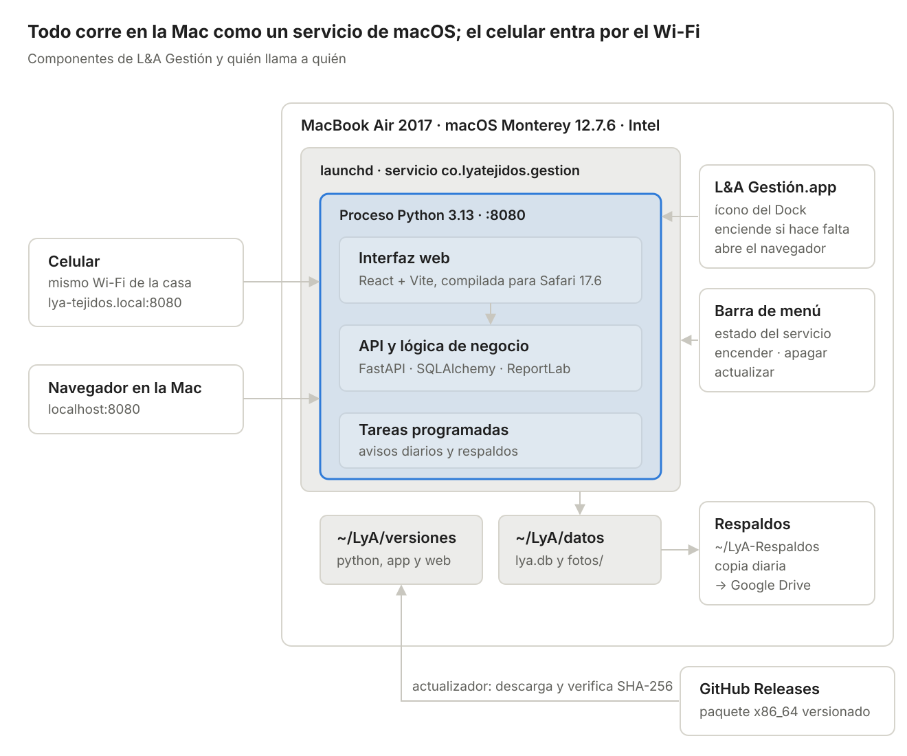

# L&A Tejidos — Arquitectura del sistema de gestión

Oct 23, 2026 · @Luciano

## Resumen y objetivos

L&A Gestión será una aplicación web local que corre directamente en la MacBook Air de la propietaria, como un servicio de macOS y sin Docker, y se usa desde el navegador de la Mac o desde el celular conectado al mismo Wi-Fi. Un ícono en el Dock la abre y otro en la barra de menú la enciende o la apaga. Cubre cuatro frentes: inventario (productos terminados e insumos), ventas y contabilidad de caja, avisos automáticos y estadísticas.

Objetivos de la versión 1:

- Saber en todo momento qué hay en existencia: bolsos, accesorios e insumos (hilos, cuentas de murano y cristal, herrajes, forros, argollas, empaques).

- Registrar una venta o un gasto en menos de un minuto, también desde el celular en una feria.

- Conocer el costo real y el margen de cada variante, incluidas las horas de trabajo a mano.

- Recibir avisos de insumos por agotarse, pedidos por entregar y abonos pendientes.

- Instalar y usar sin conocimientos técnicos; los datos no salen de la Mac, salvo las copias de respaldo.

Fuera de alcance en v1: facturación electrónica DIAN, tienda en línea, acceso desde fuera de la casa y contabilidad de partida doble.

## Contexto, usuaria y restricciones

La Mac es una **MacBook Air de 13" de 2017**: Intel Core i5 de dos núcleos a 1,8 GHz, 8 GB de RAM DDR3 y macOS Monterey 12.7.6 (confirmado el 27/10/2026). Monterey es la última versión que Apple permite en este modelo (fuente), y ya no recibe parches de seguridad. Eso define tres cosas:

- **Sin Docker.** Docker Desktop solo soporta la versión actual de macOS y las dos anteriores (fuente): hoy 27, 26 y 15. Una versión vieja de Docker quedaría sin actualizaciones, y su máquina virtual se llevaría unos 2 GB de los 8. La app corre directamente en macOS como un servicio de launchd.

- **Procesador Intel (x86_64).** El paquete se arma para x86_64, y también para arm64, para que el mismo instalador sirva cuando cambie de Mac.

- **Safari 17.6.** Es el último Safari para Monterey; la interfaz se compila y se prueba para esa versión.

**Usuaria.** Maneja con soltura Instagram, TikTok y WhatsApp, pero no tiene conocimientos técnicos. Vende por redes con envíos a todo el país desde Pueblo Nuevo, Córdoba, con entrega inmediata y por encargo, y en ferias como el Showroom de Montería Design Week en la Universidad del Sinú.

**Datos del entorno:**

| Dato | Valor | Por qué importa |
|---|---|---|
| Equipo | MacBook Air 13" (2017), Intel Core i5 1,8 GHz de dos núcleos | Paquete x86_64 |
| Memoria | 8 GB | Sin máquina virtual, el servicio usa menos de 300 MB |
| macOS | Monterey 12.7.6, sin más actualizaciones | Descarta Docker Desktop; interfaz para Safari 17.6 |
| Espacio libre | Bastante (se necesitan unos 5 GB) | Paquete, fotos y respaldos |
| Celular | iPhone | Resuelve nombres .local |
| Router | Lo maneja el operador | Sin IP fija; se usa el nombre .local y el QR |
| Personas que usan el sistema | Solo ella | Una sola cuenta |

**Restricciones de diseño:**

- Funciona sin internet: fuentes, íconos y librerías van dentro del paquete, sin CDN.

- La Mac es un portátil: con la tapa cerrada o en reposo, el celular pierde acceso.

- Gatekeeper: macOS bloquea al abrir las apps sin firmar que llegan por el navegador, AirDrop, WhatsApp o Mail, porque esos programas las marcan en cuarentena. Por eso nada de L&A se descarga con el navegador: el instalador baja todo con curl y crea las apps en la propia Mac, así que no llevan esa marca y no hace falta una cuenta de Apple Developer.

- RAM limitada: un solo proceso y SQLite en lugar de un servidor de base de datos aparte.

## Módulos funcionales

Seis módulos comparten una sola base de datos; ventas e inventario se alimentan entre sí, y contabilidad, avisos y estadísticas leen de ambos.

| Módulo | Qué resuelve | Pantallas y acciones clave |
|---|---|---|
| Inventario | Existencias de productos terminados (por modelo y color) e insumos | Catálogo con foto, stock por variante, entrada de insumos, órdenes de producción, vista de insumos (total, en producción, reservado, disponible), ajustes y mermas |
| Ventas y pedidos | Ventas de entrega inmediata, pedidos por encargo con abonos, arreglos, cambios, devoluciones y clases o talleres con cupo e inscritas | Venta rápida (3 toques) con comprobante en PDF, desglose de costos por pedido (insumos, mano de obra, envío) que por defecto muestra al cliente insumos y mano de obra separados, y ella lo cambia por pedido, pedidos con estado, fecha en que debe estar listo y fecha de entrega; calendario por mes y por semana con encargos, talleres y ferias, que sugiere cuándo empezar cada encargo (fecha de listo − horas de tejido ÷ horas que teje al día) y avisa, sin impedir guardarlo, si un encargo nuevo llena la semana, abonos, datos de envío, canal de venta |
| Clientes | Saber quién compra, cuánto compra y quién debe | Ficha con contactos (WhatsApp, Instagram/TikTok, correo, dirección de envío), historial de compras, total comprado, saldo pendiente y estado de cartera; botón para abrir el chat de WhatsApp |
| Contabilidad | Flujo de caja simple: cuánto entra, cuánto sale y cuánto queda | Cuentas (Efectivo, Nequi, Daviplata, banco) con saldo inicial que ella misma llena, ingresos, gastos por categoría, gastos fijos que ella define, solo como registro, transferencias, cierre mensual |
| Avisos | Que nada se olvide | Bandeja de avisos con contador, reglas configurables |
| Estadísticas | Decidir qué tejer, qué comprar y dónde vender | Tablero mensual y por rango de fechas |

**Avisos generados cada mañana y al abrir la app:**

- Insumo o producto en vitrina en amarillo («por agotarse») al llegar a su mínimo + 25 %, o en rojo («bajo mínimo») al quedar por debajo; el mínimo lo pone ella en cada insumo y cada variante. También avisa cuando a un encargo le falta algún insumo: al crearlo, y otra vez 3 días antes de su fecha de inicio sugerida (editable) si todavía no ha empezado.

- Encargo que debe estar listo hoy o en los próximos 3 días (anticipación editable), o que ya está atrasado.

- Pedido «Listo» con el 50 % restante sin cobrar, o que sigue sin cobrarse más días de los configurados (7 por defecto) después de quedar listo.

- Feria o evento próximo que ella registre, como el festival de cada noviembre, para preparar la vitrina con tiempo.

- Temporadas fuertes: Día de la Madre (mayo), Amor y Amistad (septiembre), Navidad; avisa 4 semanas antes.

- Producto sin ventas en 90 días (estancado en vitrina), o vendido por debajo de su costo.

- Último respaldo con más de 2 días.

**Estadísticas del tablero:**

- Ventas por día y por mes, gastos y ganancia, con comparación contra el mes anterior; productos en vitrina en unidades y en valor a costo y a precio de venta.

- Ventas por canal (Instagram, TikTok, WhatsApp, ferias, presencial) y por categoría (crochet, murano, cristal, talleres).

- Modelos y colores más vendidos; margen por modelo; productos estancados en vitrina.

- Ticket promedio, número de pedidos, ventas por cliente y clientes que más compran.

- Cartera total y por cliente, por antigüedad (0–30, 31–60 y más de 60 días); gastos por categoría, insumos más consumidos, merma por insumo y evolución del precio de cada insumo.

- Rendimiento de cada feria: ventas contra costo del stand.

**Reglas de negocio:**

- Vender un producto de vitrina descuenta su stock al guardar la venta. Un encargo no pasa por la vitrina: se fabrica para ese cliente.

- Toda fabricación es una orden de producción, para vitrina o para un encargo. Al crearla muestra el detalle de insumos que va a usar según la receta de la variante (las piezas únicas no tienen receta: los insumos se agregan a mano); al iniciarla pasa esos insumos a «En producción», donde dejan de estar disponibles pero siguen contando en la existencia total; al terminarla le pregunta cuánto usó realmente de cada insumo, con lo de la receta ya prellenado. Por cada insumo con sobrante, ella marca si aún sirve (vuelve a disponible) o no sirve (sale como merma). Lo usado se consume definitivamente y, si es de vitrina, suma las unidades a la variante. Si una orden se cancela, lo que no se usó vuelve a disponible. Se puede iniciar aunque falte algún insumo: el faltante queda en negativo, marcado en rojo, hasta registrar la compra.

- Costo de una variante = Σ (cantidad de insumo de su receta × precio vigente) + horas de tejido del modelo × valor hora editable (10.000 COP por defecto). Las horas cuentan todo el trabajo: tejer, armar, forrar y poner herrajes.

- Un encargo se cobra con 50 % de anticipo y 50 % al terminarlo, antes de entregar: el pedido no pasa a «Enviado» ni «Entregado» con saldo pendiente. Saldo = total − Σ pagos. La cartera de un cliente es la suma de los saldos de sus encargos; no se fía ni se vende a cuotas.

- Cada pago crea un ingreso en la cuenta elegida; cada compra crea un egreso; mover dinero entre cuentas es una transferencia, no un ingreso.

- Los retiros personales tienen su propia categoría para no confundir la utilidad del negocio. En postventa, un cambio reingresa la variante al stock y registra la nueva salida, cobrando o devolviendo la diferencia; una devolución reingresa el stock y crea un egreso en la cuenta de donde sale el dinero; un arreglo es un pedido de tipo «Arreglo» que no descuenta productos y puede consumir insumos.

- Montos en pesos colombianos sin decimales ($ 125.000), fechas DD/MM/AAAA, zona horaria America/Bogota.

## Arquitectura técnica

Un solo proceso de Python sirve la interfaz y la API en el puerto 8080 y guarda todo en ~/LyA/datos: base SQLite y fotos. launchd, el administrador de servicios de macOS, lo arranca al iniciar sesión y lo reinicia si se cae. Menos piezas significa menos RAM, arranque en segundos y un respaldo que es un solo archivo.


*arquitectura · 1 servicio, 1 carpeta de datos*

El celular y el navegador de la Mac llegan al mismo servicio por el puerto 8080. El ícono del Dock y el de la barra de menú solo lo encienden, lo apagan y abren el navegador; el actualizador trae versiones nuevas de GitHub Releases, y los respaldos salen de la carpeta de datos hacia ~/LyA-Respaldos.

| Capa | Tecnología | Motivo |
|---|---|---|
| Interfaz | React + Vite + TypeScript, Tailwind CSS, compilada para Safari 17.6; manifiesto web para acceso directo en el iPhone | Una sola interfaz adaptable a Mac y celular |
| API | Python 3.13 + FastAPI sobre Uvicorn, validación con Pydantic | Tipado, documentación automática de la API en /docs |
| Datos | SQLite en modo WAL con SQLAlchemy 2 y migraciones con Alembic | Sin servidor aparte; un archivo fácil de respaldar |
| Tareas | APScheduler dentro del mismo proceso | Avisos diarios y respaldos sin otro proceso |
| Fotos | Pillow: redimensiona a 1200 px y miniatura de 300 px | Fotos del celular de 4 MB quedan en ~200 KB |
| Gráficas y exportes | ECharts empaquetado en el front; openpyxl para Excel | Funciona sin internet; datos portables |
| Comprobantes | PDF imprimible con ReportLab, con el logo y los colores de la app | Trae ruedas precompiladas para Mac; WeasyPrint necesitaría Pango y Cairo instalados con Homebrew, que ya no da soporte oficial a Monterey |
| Paquete | Python 3.13 autónomo (python-build-standalone) + dependencias + interfaz compilada, en un .tar.gz por arquitectura (x86_64 y arm64), armado en GitHub Actions y publicado en GitHub Releases con su SHA-256 | No depende del Python ni de Homebrew de la Mac |
| Servicio | LaunchAgent de launchd: arranca al iniciar sesión (RunAtLoad) y se reinicia si se cae (KeepAlive) | Reemplaza a Docker; no pide contraseña de administrador |
| Lanzador | L&A Gestión.app en el Dock (AppleScript compilado en la Mac con osacompile) e ícono en la barra de menú (Python con rumps) | Un clic para abrir; encender y apagar sin abrir la Terminal |

**Flujo de una petición:** el navegador (Mac o celular) pide http://lya-tejidos.local:8080; Uvicorn escucha en 0.0.0.0:8080; FastAPI sirve los archivos estáticos de React y responde /api/* leyendo y escribiendo en ~/LyA/datos/lya.db.

**Caché del navegador:** Safari guarda en caché más que otros navegadores, y si una dirección no dice nada sobre caché puede reutilizar una respuesta vieja; con un PDF eso significa entregar siempre el mismo comprobante. Reglas:

- Todas las respuestas de /api/*, incluidos los PDF, llevan Cache-Control: no-store.

- Cada PDF se pide con una dirección que cambia cuando cambia su contenido: /api/pedidos/12/comprobante.pdf?v=<fecha de última modificación del pedido>.

- Los PDF se generan en memoria en cada petición y nunca se guardan como archivo para servirlos después.

- index.html se sirve con Cache-Control: no-cache, para que después de una actualización Safari cargue la interfaz nueva. Los archivos JS y CSS de Vite llevan una huella en el nombre y se sirven con caché larga (immutable).

**Integración continua (GitHub Actions):**

- En cada push: pruebas del backend (pytest) y del frontend (Vitest) en Ubuntu, y compilación de React.

- Al crear una etiqueta vX.Y.Z: arma los paquetes x86_64 y arm64 (Python autónomo, dependencias instaladas con uv para esa plataforma con --python-platform, interfaz compilada), calcula el SHA-256 de cada uno y los publica en GitHub Releases junto con instalar.sh.

- Rechaza la versión si alguna dependencia no tiene rueda para macOS x86_64 o pide una versión de macOS mayor que la 12.

- Prueba de caché: genera un comprobante, cambia el pedido, lo genera otra vez y comprueba que el PDF cambió y que las respuestas traen no-store.

- Prueba de humo en un runner macOS Intel (macos-15-intel, mientras GitHub lo ofrezca): descomprime el paquete, arranca el servicio y llama a /api/salud. La prueba final de cada versión se hace en la Mac real antes de publicarla.

**Alternativas descartadas:** TypeScript (Node + Fastify) y C# (ASP.NET Core) para el backend. Docker Desktop, Colima y OrbStack para la ejecución: Docker Desktop ya no soporta Monterey, Colima solo se maneja por terminal y OrbStack pide licencia para uso comercial. Tauri o Electron traerían una app descargada sujeta a Gatekeeper sin aportar nada sobre el navegador. Para subirla a la nube más adelante, toda la configuración va por variables de entorno (DATA_DIR, BACKUP_DIR, PORT), el acceso a datos pasa por SQLAlchemy (cambiar SQLite por PostgreSQL es una migración) y la app ya tiene inicio de sesión; bastaría empaquetar el mismo código en un contenedor y correrlo en un servidor con HTTPS.

## Modelo de datos

El modelo separa el **modelo** de bolso (p. ej. «Bolso balde con argollas») de sus **variantes** de color, porque el stock, las ventas y la receta de insumos se cuentan por variante: los hilos son insumos de un color y hay modelos que combinan varios colores.

| Entidad | Campos clave | Relaciones |
|---|---|---|
| Modelo | nombre, categoría (crochet, murano, cristal, otro), precio de venta, horas de tejido, foto, activo | 1–N Variante |
| Variante | color o combinación de colores, SKU, stock, stock mínimo, foto propia, pieza única (sí/no) | N–1 Modelo, 1–N RecetaItem (ninguno si es pieza única) |
| Insumo | nombre, tipo (hilo, cuentas, herraje, forro, argolla, empaque), unidad editable que ella define (metros, gramos, unidades, paquetes…), con conversión opcional de compra (p. ej. 1 cono = 400 m), precio vigente (con historial en PrecioInsumo), stock, stock mínimo, proveedor | 1–N RecetaItem |
| RecetaItem | cantidad de insumo por unidad de la variante, en la unidad que ella definió para el insumo | Variante × Insumo |
| MovimientoInventario | fecha, tipo (compra, inicio de producción, consumo al terminar, liberación por cancelación, ingreso a vitrina, venta, devolución, cambio, ajuste, merma), cantidad, costo unitario, referencia | Variante o Insumo |
| Compra | fecha, proveedor, total, cuenta de pago | 1–N ítems de insumo; genera Transacción |
| Cliente | obligatorios: nombre, WhatsApp, dirección y ciudad de envío; opcionales: Instagram/TikTok, correo, cédula, notas. Las ventas de feria pueden ir a «Cliente de mostrador» | 1–N Pedido |
| Pedido | fecha, canal, tipo (inmediata, encargo o arreglo), estado, fecha en que debe estar listo, fecha de entrega, envío (ciudad, transportadora, costo, quién lo paga: cliente o negocio, contraentrega sí o no), descuento, total, fecha límite de pago | 1–N PedidoItem, 1–N Pago; N–1 Evento |
| PedidoItem | cantidad, precio unitario, costo unitario congelado al vender | N–1 Variante |
| Pago | fecha, monto, método | N–1 Pedido, N–1 Cuenta; genera Transacción |
| Cuenta | nombre (Efectivo, Nequi, Daviplata, banco), saldo inicial | 1–N Transacción |
| Transacción | fecha, tipo (ingreso, egreso, transferencia), categoría, monto, descripción | N–1 Cuenta; opcional a Pago o Compra |
| Categoría | nombre, tipo (ingreso o gasto): insumos, envíos, publicidad, stand de feria, empaques, transporte, servicios, retiro personal | 1–N Transacción |
| Evento | nombre, fecha, lugar, costo del stand | 1–N Pedido |
| Aviso | tipo, mensaje, fecha, leído, entidad de origen | — |
| Usuario y Configuración | usuario, hash de contraseña, rol; nombre del negocio, valor hora, horas de tejido por día, días de alerta | — |

Estados del pedido: Cotizado → Apartado (50 %) → En proceso → Listo → Pagado (100 %) → Enviado → Entregado, con Cancelado desde cualquier estado anterior a Entregado. Los costos se congelan en PedidoItem para que la utilidad histórica no cambie cuando suba el precio de un insumo. Los combos y promociones de temporada se modelan como una entidad Promoción (nombre, vigencia, variantes incluidas, precio o porcentaje) que se aplica a los ítems del pedido; los descuentos puntuales van en el pedido. Las clases y talleres se modelan como Taller (fecha, lugar, cupo, precio, insumos incluidos), con inscripciones de clientes que se cobran y entran a cartera como cualquier pedido. La fabricación se modela como OrdenProducción (destino: vitrina o encargo; variante, cantidad; estado: planeada, en proceso, terminada; fechas de inicio sugerida, de inicio real y de fin), con sus insumos calculados desde la receta y ajustables; cada insumo se ve en cuatro cifras: existencia total (incluye lo que está en producción), en producción, reservado por órdenes planeadas y disponible = total − en producción − reservado. Las alertas de stock mínimo usan la cifra disponible. Los precios nunca se sobrescriben: cada compra o edición manual crea un registro en PrecioInsumo (insumo, precio por unidad, fecha desde, origen: compra o edición). El precio vigente sirve para recetas y cotizaciones; cada compra guarda lo que realmente pagó y cada orden de producción congela el costo de sus insumos al iniciarse, así los gastos y la ganancia de meses anteriores no cambian cuando sube un precio.

## Despliegue y acceso desde el celular

Todo vive en la carpeta de inicio de la usuaria, así que nada pide contraseña de administrador:

```
~/LyA/
  versiones/1.0.0/   paquete descomprimido: python/, app/, web/
  actual             enlace a la versión en uso (versiones/1.0.0)
  datos/             lya.db y fotos/
  registros/         salida del servicio y de la barra de menú
~/LyA-Respaldos/     copias diarias, sincronizadas con Google Drive
~/Library/LaunchAgents/
  co.lyatejidos.gestion.plist   el servicio
  co.lyatejidos.menu.plist      el ícono de la barra de menú
/Applications/L&A Gestión.app  el ícono del Dock (~/Applications si su usuario no es administrador)
```

El servicio es un LaunchAgent (deploy/co.lyatejidos.gestion.plist). El instalador cambia __HOME__ por la carpeta de inicio, porque launchd no expande ~ ni $HOME:

```xml
<key>Label</key>             <string>co.lyatejidos.gestion</string>
<key>ProgramArguments</key>  <array>
                               <string>__HOME__/LyA/actual/python/bin/python3</string>
                               <string>-m</string> <string>app</string>
                             </array>
<key>EnvironmentVariables</key>
<dict>
  <key>TZ</key>          <string>America/Bogota</string>
  <key>DATA_DIR</key>    <string>__HOME__/LyA/datos</string>
  <key>BACKUP_DIR</key>  <string>__HOME__/LyA-Respaldos</string>
  <key>PORT</key>        <string>8080</string>
</dict>
<key>RunAtLoad</key>         <true/>
<key>KeepAlive</key>         <true/>
<key>ThrottleInterval</key>  <integer>10</integer>
```

- **Arranque:** RunAtLoad lo enciende cada vez que ella inicia sesión, y KeepAlive lo reinicia si se cae.

- **Apagar:** launchctl bootout gui/$(id -u)/co.lyatejidos.gestion. El servicio queda apagado hasta que ella lo encienda o hasta el próximo inicio de sesión, cuando launchd lo vuelve a arrancar solo. Así, un apagado por error nunca deja al celular sin acceso más de un día.

- **Encender:** launchctl bootstrap gui/$(id -u) ~/Library/LaunchAgents/co.lyatejidos.gestion.plist.

- **Estado:** /api/salud responde con la versión y el estado de la base.

**Ícono de la barra de menú** (deploy/co.lyatejidos.menu.plist, Python con rumps): otro LaunchAgent, limitado a la sesión gráfica, que corre con el mismo Python del paquete y sin ícono en el Dock. Muestra:

- el estado: «L&A encendida» o «L&A apagada», revisado cada 10 segundos;

- «Abrir L&A»;

- «Apagar L&A», que pide confirmación: «Si la apagas, el celular no podrá entrar hasta que la enciendas o reinicies la Mac»;

- «Encender L&A»;

- «Buscar actualizaciones» y «Copiar diagnóstico».

No tiene opción para salir, para que el control de encendido siempre esté a mano.

**Ícono del Dock:** L&A Gestión.app es un AppleScript que el instalador compila en la Mac con osacompile y que lleva el logo como ícono. Al abrirlo: si /api/salud responde, abre el navegador; si no, enciende el servicio, espera hasta 30 segundos y abre el navegador. Si Chrome está instalado, se abre en modo app (--app=http://localhost:8080), en una ventana propia; si no, en una pestaña de Safari, porque Safari en Monterey no permite agregar sitios al Dock.

**Acceso por red local:**

- Uvicorn escucha en todas las interfaces (0.0.0.0:8080), así que la app queda visible en el Wi-Fi de la casa.

- En Preferencias del Sistema → Compartir, el nombre del equipo se cambia a lya-tejidos; la dirección queda http://lya-tejidos.local:8080.

- El firewall de macOS viene apagado por defecto. Si está activo, el instalador autoriza el python3 del paquete con socketfilterfw (pide la contraseña de la Mac una vez).

- El router lo maneja el operador, así que no se reserva IP. No hace falta: aunque la IP cambie, el iPhone sí resuelve .local.

- El servicio obtiene la IP con ipconfig getifaddr en0 cada vez que la necesita; la app muestra siempre en el menú un botón «Entrar desde el celular» con un código QR y el enlace, con el nombre .local y la IP actual como respaldo.

- En el celular se escanea el QR y se agrega a la pantalla de inicio; abre como una app.

**Lo que el celular puede y no puede hacer:**

- Puede tomar fotos de productos con <input type="file" accept="image/*" capture>, que funciona sin HTTPS.

- No tendrá modo sin conexión: los service workers exigen HTTPS, y montar certificados locales en cada celular es demasiado para la usuaria. No hace falta, porque sin la Mac encendida no hay datos que consultar.

- Solo funciona con la Mac encendida, despierta, con L&A encendida y en el mismo Wi-Fi. Con el cargador conectado se activa la opción de evitar el reposo automático cuando la pantalla esté apagada (Preferencias del Sistema → Batería → Adaptador de corriente); con la tapa cerrada la Mac duerme igual.

- En ferias sin el Wi-Fi de la casa: se lleva la Mac y se comparte internet desde el celular, o se anotan las ventas y se registran al volver. La venta rápida está pensada para registrarse en segundos después.

## Instalación, actualizaciones y respaldos

La instalación la haces tú una sola vez, en persona o por videollamada, con un comando en la Terminal. Ella nunca abre la Terminal ni edita archivos; recibe una guía de una página con capturas del ícono del Dock, el de la barra de menú y el QR del celular.

**Instalación (unos 10 minutos, una sola vez):**

- **Instalar L&A.** Abrir Terminal y pegar:

  ```
  curl -fsSL https://github.com/luchm27/lya-gestion/releases/latest/download/instalar.sh | bash
  ```

  Si el repositorio del código es privado, los paquetes se publican en un repositorio público aparte que solo tiene los releases. El instalador:

  - detecta la arquitectura (uname -m), baja el paquete de la versión más reciente y verifica su SHA-256;

  - lo descomprime en ~/LyA/versiones/<versión> y apunta ~/LyA/actual a esa carpeta;

  - crea ~/LyA/datos, ~/LyA/registros y ~/LyA-Respaldos;

  - escribe los dos LaunchAgents y los carga con launchctl bootstrap;

  - compila L&A Gestión.app con osacompile, le pone el logo como ícono y la agrega al Dock;

  - si el firewall está activo, autoriza el python3 del paquete;

  - espera a que /api/salud responda y abre el navegador en http://localhost:8080.

- **Sin avisos de Gatekeeper.** Nada de esto pasa por el navegador, así que macOS no marca los archivos en cuarentena y no aparece el aviso de desarrollador no verificado. No hace falta firmar ni notarizar.

- **Nombre del equipo:** Preferencias del Sistema → Compartir → lya-tejidos.

- **Asistente de primera vez** (dentro de la app): crear usuario y contraseña, nombre del negocio, cuentas de dinero con saldo inicial, valor de la hora de tejido y categorías sugeridas, que se pueden editar.

- **Conectar el celular:** botón «Entrar desde el celular» → escanear el QR → «Agregar a pantalla de inicio».

**Uso diario:** ella abre L&A Gestión desde el Dock. Si el servicio está encendido, el navegador se abre al instante; si estaba apagado, lo enciende y lo abre en cuanto responde. Si algo falla, muestra un mensaje en español con un botón «Reintentar» y otro «Copiar diagnóstico» (versión, estado del servicio y últimas líneas del registro) para enviártelo por WhatsApp. Para apagarla o encenderla usa el ícono de la barra de menú.

**Actualizaciones:**

- Cada versión se publica con etiqueta semántica (1.0.0, 1.1.0) en GitHub Releases: un paquete por arquitectura, su SHA-256 y el instalador. El servicio siempre corre una versión concreta, nunca «la última» sin confirmar.

- Una vez por semana, si hay internet, la barra de menú consulta GitHub Releases y, si hay versión nueva, pregunta «¿Actualizar ahora?». También se puede buscar a mano.

- El actualizador corre en el proceso de la barra de menú, no en el servicio, para poder reiniciarlo y vigilar que vuelva. Descarga con Python, así que el paquete tampoco queda en cuarentena.

- Al aceptar: respaldo automático → descarga y verificación del SHA-256 → descompresión en versiones/<nueva> → actual apunta a la nueva → launchctl kickstart -k reinicia el servicio → la app aplica migraciones al arrancar. Si /api/salud no responde en 60 segundos, actual vuelve a la versión anterior y se restaura el respaldo previo, porque las migraciones pudieron cambiar la base. Se conservan las dos últimas versiones.

**Respaldos:**

- Diario a las 9:00 p. m. y antes de cada actualización: VACUUM INTO genera una copia consistente de la base, que se comprime en un .zip con las fotos.

- Se guardan en ~/LyA-Respaldos: los últimos 30 diarios y uno por mes durante un año. Van en la carpeta de inicio y no en Documentos, porque macOS pide permiso de privacidad para que un proceso en segundo plano escriba en Documentos.

- Google Drive para escritorio sincroniza la carpeta LyA-Respaldos con su cuenta de Google (Preferencias → Mi Mac → Agregar carpeta), así las copias suben a la nube solas. Se respalda la copia, nunca la base viva: sincronizar un SQLite abierto puede dañarlo.

- Restaurar: Ajustes → Respaldos → elegir fecha → confirmar.

- Exportar a Excel cualquier listado (ventas, gastos, inventario) para el contador o para declarar.

## Seguridad, requisitos no funcionales e identidad visual

Cualquiera conectado al Wi-Fi de la casa puede llegar al puerto 8080, así que la app exige inicio de sesión aunque sea local.

**Seguridad:**

- Usuario y contraseña con hash Argon2id; sesión en cookie HttpOnly y SameSite=Strict que dura 30 días en cada dispositivo.

- Límite de 5 intentos fallidos por minuto; recuperación con un código de 8 dígitos impreso en la guía de instalación.

- Una sola usuaria, la dueña; la tabla de usuarios queda lista por si después entra una ayudante.

- Sin redirección de puertos en el router: nada queda expuesto a internet.

- Recomendar FileVault activo en la Mac (Preferencias del Sistema → Seguridad y privacidad → FileVault), porque la base contiene datos de clientes.

- Monterey ya no recibe parches de seguridad: por eso la app se queda en la red local, con inicio de sesión y sin puertos abiertos a internet. Cuando ella cambie de Mac, el mismo instalador sirve en Apple silicon.

**Requisitos no funcionales:**

| Requisito | Meta |
|---|---|
| Arranque desde el ícono del Dock | < 10 s con el servicio apagado; < 2 s con el servicio encendido |
| Respuesta de pantallas | < 300 ms con 10.000 ventas registradas en la Mac de 2017 |
| Memoria del servicio | < 300 MB en uso normal |
| Tamaño del paquete | < 200 MB descomprimido, con Python incluido |
| Navegadores | Safari 17.6 (Monterey), Safari de iOS actual y Chrome |
| Uso en celular | Pantallas desde 360 px de ancho, botones de al menos 44 px |
| Idioma y formato | Español de Colombia, pesos sin decimales, DD/MM/AAAA |
| Pérdida máxima de datos | Un día (respaldo diario) |

**Identidad visual** tomada del logo de L&A Tejidos. Los códigos de color son aproximados y se ajustan tomando muestras del archivo original del logo:

| Uso | Color | Hex aprox. |
|---|---|---|
| Fondo de encabezado y pantalla de inicio de sesión | Rosa palo del fondo del logo | #E8AFCB |
| Botón principal y acentos | Rosa intenso de las peonías | #D9487E |
| Estados positivos (pagado, en stock) | Verde menta del ovillo | #5DBFA3 |
| Destacados y totales | Dorado de los bolsos | #C9A227 |
| Texto | Negro tinta | #1F1A1D |
| Fondo general | Blanco cálido | #FFF8FB |

El logo completo se usa en el inicio de sesión y como ícono de la app; en el encabezado va solo «L&A». La interfaz usa una tipografía sans redondeada (Nunito o Poppins) incluida en el paquete; la letra cursiva queda solo para el logo. Las fotos de los productos son las protagonistas del catálogo. Hay tema claro y oscuro: sigue el del sistema y se puede fijar a mano.

## Opciones de diseño abiertas

Lo descrito en las secciones anteriores es la propuesta recomendada, no una decisión cerrada. Cada fila queda abierta hasta responder las preguntas indicadas en la última columna.

| # | Decisión | Opciones | Recomendación | Se resuelve con |
|---|---|---|---|---|
| 1 | Forma de ejecución | Docker Desktop · OrbStack · Colima · servicio nativo con launchd · app de escritorio con Tauri o Electron | Decidido: servicio nativo con launchd. La Mac es Intel con Monterey 12.7.6, que Docker Desktop ya no soporta | A1, G5 |
| 2 | Lenguaje del backend | TypeScript (Node + Fastify) · C# (ASP.NET Core) · Python (FastAPI) | Decidido: Python con FastAPI | G1 |
| 3 | Base de datos | SQLite en un archivo · PostgreSQL como servidor aparte | Decidido: SQLite, por menos RAM y un respaldo de un solo archivo | A1, B4 |
| 4 | Forma del inventario | Por variante (modelo × color) · por pieza única con código · mixto | Decidido: mixto | B2, B3 |
| 5 | Cuándo descontar stock en encargos | Al confirmar el pedido · al marcarlo «Listo» | Decidido: los insumos se descuentan al iniciar la producción; el encargo no pasa por la vitrina | B8 |
| 6 | Contabilidad | Flujo de caja por cuentas · partida doble con PUC | Decidido: flujo de caja (negocio informal, sin contador) | C3, C4 |
| 7 | Costo de insumos | Costo promedio ponderado · último costo de compra | Decidido: precio vigente editable (última compra o el que ella ponga), con historial; compras y órdenes congelan su precio | D1, D2 |
| 8 | Usuarios | Una sola cuenta · Dueña + Ayudante | Decidido: una sola cuenta | B1 |
| 9 | Acceso del celular | Nombre .local + reserva DHCP · solo QR con la IP · HTTPS local con certificado propio | Decidido: nombre .local + botón con QR y enlace; sin reserva de IP porque el router es del operador | A6, A7 |
| 10 | Lanzador | App en AppleScript · Platypus · app de barra de menús en Swift · barra de menús en Python (rumps) | Decidido: L&A Gestión.app en AppleScript para el Dock y barra de menús con rumps para encender, apagar y actualizar; las dos se crean en la Mac. Apagar dura hasta el siguiente inicio de sesión | A1, G3 |
| 11 | Actualizaciones | Aviso semanal con confirmación · botón manual · automáticas | Aviso semanal con confirmación | A8, G2 |
| 12 | Respaldo externo | iCloud · Google Drive para escritorio · USB manual | Decidido: Google Drive para escritorio | A5 |
| 13 | Firma del instalador | Sin firmar + instalación por Terminal · Apple Developer ID (pago anual) | Decidido: sin firmar. Todo se baja con curl o Python y las apps se crean en la Mac, así que Gatekeeper no interviene | G2 |
| 14 | Canal de avisos | Solo dentro de la app · notificaciones push (requieren internet y un servicio externo) · mensaje de WhatsApp | Decidido: dentro de la app | E2 |
| 15 | Acceso fuera de casa | No · VPN privada (p. ej. Tailscale) · migrar a un servidor en la nube | Decidido: no en la v1, pero con la arquitectura lista para migrar a la nube | A4, G6 |
| 16 | Comprobante de venta | Ninguno · imagen o PDF para WhatsApp · impresora | Decidido: PDF imprimible | F2 |
| 17 | Generador de PDF | WeasyPrint · ReportLab · imprimir desde el navegador | Decidido: ReportLab, que no necesita librerías del sistema; WeasyPrint pide Pango y Cairo vía Homebrew | A1 |

## Preguntas para dejar todo claro

Las preguntas A a F son para tu prima y la G es para ti; la columna Respuesta se llena aquí mismo. Ya están respondidas las 46 y ninguna bloquea.

### A. La Mac y el entorno

| # | Pregunta | Por qué importa | Respuesta |
|---|---|---|---|
| A1 | ¿Qué chip, memoria y versión de macOS tiene? (menú Apple → Acerca de esta Mac) | Arquitectura del paquete, memoria y forma de ejecución | MacBook Air 13" (2017), Intel Core i5 1,8 GHz de dos núcleos, 8 GB, macOS Monterey 12.7.6, la última para ese modelo. Se descarta Docker: servicio nativo con launchd |
| A2 | ¿Cuánto espacio libre tiene el disco? | Se necesitan unos 5 GB | Bastante |
| A3 | ¿Usa la Mac para tareas pesadas, como editar videos para TikTok o Reels? | Con 8 GB, la app y la edición compiten por memoria | No |
| A4 | ¿La Mac se queda en casa conectada al cargador o la lleva a ferias y a la calle? | Define si el celular podrá entrar con frecuencia | Por lo general se queda en casa |
| A5 | ¿Usa iCloud, con «Escritorio y Documentos» activo? ¿Cuánto espacio tiene? | Destino de los respaldos | Respaldos en Google Drive |
| A6 | ¿Qué celulares van a entrar: iPhone o Android, y cuántos? | Resolución de .local y pruebas de pantalla | iPhone |
| A7 | ¿Tiene la clave de administración del router o lo maneja el operador? | Reservar una IP fija para la Mac | Lo maneja el operador; se usa el QR y el nombre .local |
| A8 | ¿Qué tan estable es el internet de la casa? | Descarga inicial y actualizaciones | Estable |
| A9 | ¿Sabe la contraseña de usuario de la Mac? | La piden el cambio de nombre del equipo y, si el firewall está activo, la autorización de la app | Sí |

### B. Negocio, productos y ventas

| # | Pregunta | Por qué importa | Respuesta |
|---|---|---|---|
| B1 | ¿Cuántas personas trabajan en L&A y quiénes usarían el sistema? | Usuarios y roles | Solo ella |
| B2 | ¿Cada pieza es única o el mismo modelo se repite en varios colores? | Forma del inventario | Mixto |
| B3 | ¿Cuántos modelos y unidades tiene hoy en inventario, aproximadamente? | Carga inicial y diseño del catálogo | No hace falta; ella lo carga en el programa |
| B4 | ¿Cuántas ventas hace por semana en temporada normal y en una feria? | Rendimiento y diseño de la venta rápida | No hace falta |
| B5 | ¿Por qué canales vende: Instagram, TikTok, WhatsApp, ferias, tienda física, consignación en otras tiendas? | Lista de canales y estadísticas por canal | Instagram/TikTok, WhatsApp, ferias y presencial |
| B6 | ¿Vende al por mayor o a revendedoras con otro precio? | Listas de precios | No |
| B7 | ¿Vende algo además de productos terminados: insumos, kits, clases o talleres? | Tipos de producto y de ingreso | Productos terminados y clases o talleres |
| B8 | En encargos, ¿cobra anticipo? ¿De qué porcentaje? ¿Cuánto tarda en entregar? | Abonos, estados y avisos de entrega | 50 % de anticipo y 50 % al terminar, antes de entregar |
| B9 | ¿Con qué transportadoras envía, quién paga el envío y ofrece contraentrega? | Con contraentrega el dinero llega días después por la transportadora | Depende del pedido |
| B10 | ¿Maneja descuentos, combos o precios de temporada? | Reglas de precio en la venta | Descuentos puntuales y combos de temporada |
| B11 | ¿Hace cambios, devoluciones o arreglos? | Movimientos de inventario y de caja inversos | Arreglos, cambios y devoluciones de dinero |
| B12 | ¿Trabaja con tejedoras externas a las que paga por pieza? | Costo del producto y pagos a terceros | No, teje solo ella |

### C. Dinero y contabilidad

| # | Pregunta | Por qué importa | Respuesta |
|---|---|---|---|
| C1 | ¿Qué medios de pago recibe (efectivo, Nequi, Daviplata, transferencia, datáfono o link de pago) y cuáles cobran comisión? | Cuentas y descuento de comisiones | Efectivo, Nequi/Daviplata y transferencia; sin datáfono |
| C2 | ¿Separa el dinero del negocio del personal? | Categoría de retiros y utilidad real | Sí, separa el dinero del negocio del personal |
| C3 | ¿Tiene RUT o está formalizada? ¿En qué régimen? ¿Tiene contador o debe facturar electrónicamente? | Define si basta flujo de caja o hace falta más | Informal, sin RUT |
| C4 | ¿Cómo lleva hoy las cuentas: cuaderno, Excel o alguna app? ¿Hay historial para pasar al sistema? | Migración de datos | Cuaderno; se empieza con saldos iniciales |
| C5 | ¿Qué gastos fijos tiene: internet, publicidad pagada, arriendo, servicios? | Categorías y gastos recurrentes | Editables en el programa |
| C6 | ¿Cómo fija hoy el precio de un bolso? ¿Cuánto cree que vale su hora de trabajo? | Fórmula de costo y margen | Hora a 10.000 COP, editable |
| C7 | ¿Desde qué fecha quiere empezar a registrar, y cuánto hay en cada cuenta ese día? | Saldos iniciales | Ella llena los saldos en el asistente inicial |

### D. Insumos

| # | Pregunta | Por qué importa | Respuesta |
|---|---|---|---|
| D1 | ¿Qué insumos usa y en qué unidad los compra (conos por gramos, cuentas por paquete, herrajes por unidad)? | Unidades de medida y conversión | Se configura en el programa |
| D2 | ¿Quiénes son sus proveedores habituales? ¿Compra en línea o en tiendas locales? | Registro de compras y proveedores | Se configura en el programa |
| D3 | ¿Puede estimar cuánto insumo y cuántas horas lleva cada modelo? | Recetas y costo por variante | Receta por variante (hay modelos que combinan colores), con cualquier insumo que ella haya creado; las horas cuentan todo el trabajo; las piezas únicas van sin receta y se registra lo usado. Mientras tanto se trabaja con datos de ejemplo |
| D4 | ¿Le interesa controlar sobrantes y retazos, o le basta un stock aproximado? | Nivel de detalle del inventario | Al terminar cada orden registra lo usado y marca, por insumo, si el sobrante sirve o no |
| D5 | ¿Cada cuánto cuenta físicamente lo que tiene? | Pantalla de conteo y ajustes | Se maneja con el conteo y los ajustes del programa |

### E. Avisos y estadísticas

| # | Pregunta | Por qué importa | Respuesta |
|---|---|---|---|
| E1 | ¿Qué se le olvida hoy o qué le preocupa no saber a tiempo? | Prioridad de las reglas de aviso | Mínimo de stock por insumo, definido por ella |
| E2 | ¿Le basta ver los avisos al abrir la app, o quiere notificaciones en el celular? | Las notificaciones requieren internet y un servicio externo | Dentro de la app |
| E3 | ¿Qué números quiere ver cada mes? | Contenido del tablero | Ventas por día y mes, más vendidos, gastos, ganancias, productos en vitrina |
| E4 | ¿Qué ferias o fechas especiales se repiten cada año? | Calendario de avisos de temporada | Un festival cada noviembre; ella registra los eventos en el programa |

### F. Uso e interfaz

| # | Pregunta | Por qué importa | Respuesta |
|---|---|---|---|
| F1 | ¿Lo usaría más desde el celular o desde la Mac? | Qué pantallas se diseñan primero | Ambos por igual |
| F2 | ¿Quiere enviar comprobantes de venta por WhatsApp o imprimir recibos? | Generación de comprobantes | PDF imprimible |
| F3 | ¿Tiene el logo en alta resolución o en un archivo editable (Canva, PNG o SVG)? | Ícono de la app e identidad visual | Sí: `assets/logo/` (900 px sin contacto; 1600 px con Instagram y WhatsApp) |
| F4 | ¿Prefiere tema claro, oscuro o ambos? | Paleta de colores | Ambos |
| F5 | ¿Qué palabras usa ella para los estados de un pedido y para sus categorías de gasto? | La app debe hablar como ella | Apartado, en proceso, listo, enviado |

### G. Técnicas y del proyecto (para ti)

| # | Pregunta | Por qué importa | Respuesta |
|---|---|---|---|
| G1 | ¿TypeScript o C# para el backend? | Stack, paquete y herramientas | Python (FastAPI) |
| G2 | ¿Cómo darás soporte: videollamada, Compartir pantalla de macOS, AnyDesk? | Diagnóstico y actualizaciones asistidas | En persona o por videollamada, según el caso |
| G3 | ¿Qué plazo y qué alcance tiene la primera entrega? | Corte de la fase 1 | Todo en una sola entrega |
| G4 | ¿Repositorio privado? ¿Quién es dueño del código y de los datos? | Acuerdos y continuidad | Código: Luciano; datos: ella |
| G5 | Si la Mac tiene 8 GB, ¿se mantiene Docker o se evalúa una app nativa? | Decisión 1 | App nativa: la Mac es Intel con Monterey 12.7.6, que Docker Desktop ya no soporta. Se ejecuta como servicio de launchd, con ícono en el Dock y en la barra de menú |
| G6 | ¿Se quiere acceso desde fuera de la casa más adelante? | Decisión 15 y si conviene migrar a la nube | Por ahora no, pero dejarlo listo para la nube |

## Riesgos, fases y verificación

El mayor riesgo no es técnico sino de uso: si registrar una venta toma más de un minuto, dejará de hacerse. Por eso la fase 1 prioriza la venta rápida y el inventario.

| Riesgo | Mitigación |
|---|---|
| Monterey ya no recibe parches de seguridad | Solo red local, inicio de sesión y nada expuesto a internet; FileVault activo; el paquete arm64 deja lista la migración a una Mac nueva |
| Una dependencia deja de publicar ruedas para macOS 12 Intel | uv.lock fija las versiones; GitHub Actions rechaza la versión si falta una rueda; prueba final en la Mac real antes de publicar |
| La interfaz falla en Safari 17.6 | Compilación con ese objetivo y pruebas en la Mac real; Chrome como alternativa |
| Safari entrega un PDF o una interfaz vieja desde su caché | no-store en /api/*, dirección del PDF con la fecha de modificación, index.html con no-cache; prueba automática y prueba en Safari de la Mac real |
| La Mac de 2017 es lenta con muchos datos | Índices en las consultas del tablero y prueba con 10.000 ventas de ejemplo en la Mac real |
| La Mac duerme y el celular pierde acceso | Ajuste de reposo con cargador; mensaje claro en el celular: «Abre la Mac» |
| Ella apaga L&A sin querer | Confirmación al apagar; se enciende sola en el siguiente inicio de sesión |
| Cambio de IP de la Mac | Nombre .local + botón con QR y enlace; el servicio lee la IP cada vez |
| Aviso de desarrollador no verificado | Nada se descarga con el navegador y las apps se crean en la Mac, así que no quedan en cuarentena |
| Pérdida o robo de la Mac | Respaldos en Google Drive; FileVault activo |
| Una actualización rompe la app | Respaldo previo, versiones separadas en ~/LyA/versiones y vuelta automática a la anterior |

**Orden de construcción (la entrega es una sola, con todo):**

- **Fase 1 · base:** inventario de variantes e insumos, venta rápida con comprobante en PDF, clientes con contactos e historial, cuentas y gastos, respaldos, instalador, íconos del Dock y de la barra de menú, y acceso por celular.

- **Fase 2 · control:** pedidos por encargo con abonos y estados, cartera por cliente, recetas y costo por variante, registro de producción, avisos.

- **Fase 3 · decisiones:** tablero de estadísticas, ferias y eventos, exportes a Excel.

**Lista de verificación antes de empezar:**

- ☑ Confirmar chip, memoria, versión de macOS y espacio libre de la Mac (27/10/2026: Intel, 8 GB, Monterey 12.7.6)

- ☐ Probar un paquete x86_64 de prueba en la Mac real: servicio, ícono del Dock, barra de menú y acceso desde el iPhone

- ☐ Confirmar tipo de celular y acceso al router

- ☐ Confirmar si habrá un usuario ayudante

- ☐ Levantar con ella la lista inicial de modelos, colores, insumos y proveedores

- ☐ Definir el valor de la hora de tejido

- ☐ Obtener el logo en alta resolución (PNG o SVG)

- ☐ Validar con ella un prototipo de la venta rápida en el celular

**Fuentes:**

- Apple: modelos compatibles con macOS Monterey y con macOS Ventura (la MacBook Air de 2017 llega hasta Monterey)

- Docker Desktop: instalación y requisitos en Mac (motivo para descartarlo)

- python-build-standalone y uv: Python autónomo y ruedas por plataforma

- Apple: launchd y los LaunchAgents (man launchd.plist, man launchctl)

